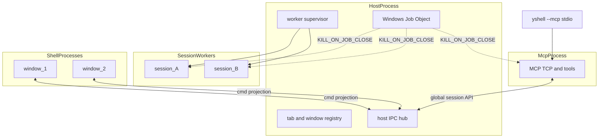
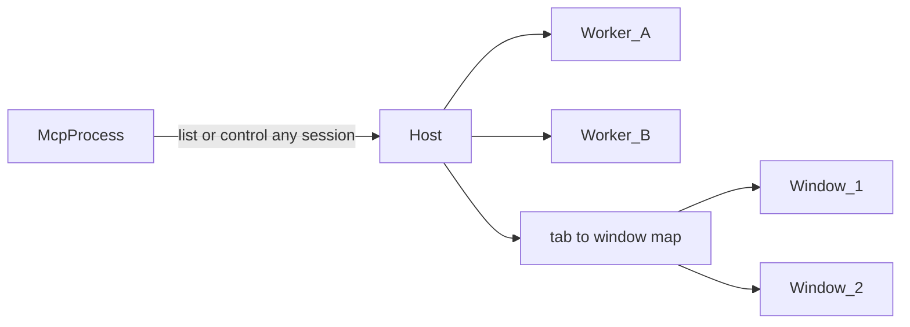

# 进程 / 多窗口架构

性质：多窗口与 MCP 相关的**技术设计真源**（进程边界、所有权、生命周期）。  
产品范围决策见 [`yshell-current-status.md`](../product/yshell-current-status.md) **D38**；UI 观感仍以本目录 HTML 原型为准。

更新：2026-11-12

---

## 1. 目标约束

- **一 session 一进程**：SSH/PTY/SFTP/终端解析在 SessionWorker；单连崩溃或卡死不影响其它 session 与 UI。
- **MCP 独立进程（监听单例）**：不挂在某个 Shell；经 Host **全局**看见/切换全部 session（跨窗）。
- **不用「MCP 宿主窗口」**：MCP 不绑定某扇窗、不维护宿主晋升链。
- **tab / 窗归属在 Host 进程**：跨窗移 tab 只改归属，不重建 Worker。
- **Shell 只做 UI**；**清理权只在 Host 进程**（窗口从不负责杀 Worker）。
- **无任何 UI 窗口 → Host 关机收尸**（与 MCP 无关）。

---

## 2. 四层进程模型

### 所有权

| 进程 | 拥有 | 不拥有 |
|---|---|---|
| **Host 进程** | 单实例锁；tab/window 注册表；Worker/MCP 监督与**唯一清理权**；向 MCP 暴露全局 session 视图 | SSH/PTY、Slint、MCP TCP 监听 |
| **SessionWorker** | 单 session 的连接、PTY/SSH、SFTP、终端 grid/日志句柄 | 窗口列表、MCP listen、杀其它 Worker |
| **McpProcess** | TCP 监听、tool 调度；经 Host 访问全部 session；endpoint 文件 | 绑定某窗；直连 Worker；画 UI |
| **Shell / 窗口** | Slint 展示与输入、对话框展示 | session 连接、MCP listen、tab 真相源、杀 Worker、「MCP 宿主」身份 |

本版不做：一 OS 窗一进程（一个 Shell 进程内仍可多 Slint 窗，对齐现 N7）。

---

## 3. MCP 与窗口

| 点 | 选定默认 |
|---|---|
| 可见性 | MCP（经 Host）枚举/操作**所有** session，不论 tab 在哪扇窗 |
| 切换 | 可随时指定 session；不绑定窗 |
| 新建连接 | Host spawn Worker + 建 tab；**展示落点**用当时合适的窗（如最近聚焦窗）——仅 UI 落点，不是 MCP 归属 |
| 落点窗关了 | tab 按普通关窗/迁窗规则处理；MCP 仍可按 session id 控制其它/新建到别的窗 |
| 退出条件 | **零 UI 窗口** → Host 关机序列；不是「MCP 没宿主」 |

`yshell --mcp`（stdio 桥）仍指向 McpProcess 写出的 endpoint；用户不手跑 `--mcp`（对齐 D34）。

---

## 4. 生命周期与防野 session

**核心原则：Shell 永不负责清理 session。** 窗口只向 Host 报告关窗/Quit；停 Worker / 停 MCP / 释锁只发生在 Host 关机序列。

### 正常路径

1. **关非最后窗**：Host 更新归属；只停本应断开的 Worker。
2. **Quit 或关到零窗**：Host 关机序列（停 McpProcess → 优雅停全部 Worker → 超时强杀 → 清 endpoint / run-state → 释单实例锁 → Host 退出）。
3. **MCP 建连**：全局 API + tab 临时落某窗展示（可带 AI 标志，对齐 D34）。

### 异常路径

| 场景 | 机制 | 结果 |
|---|---|---|
| Host 被杀 / 崩溃 | Worker + Mcp 加入 Host 的 **Windows Job Object**（`KILL_ON_JOB_CLOSE`） | OS 级联杀掉子进程 |
| Job 未生效 | Worker/Mcp **心跳**：IPC 断开或超时无 Host 应答 → **自退出** | 第二道保险 |
| 单窗异常退出 | Host 更新 tab 归属；Worker 保留（仍在其它窗或待附着） | MCP 全局视图不变 |
| **零 UI 窗** | Host **立即**关机序列 | 不把收尸交给已死窗口 |
| 冷启动残留 | 读 `run-state.json` **启动收尸** | 清野 PID / 陈旧 endpoint |
| 再开 yshell | 单实例锁：附着已有 Host，或收尸后起新 Host | 不会第二套 MCP/野 Host |

### run-state（Host 维护）

落在 config_dir（例：`run-state.json`）：

- `generation`（每次 Host 启动递增）
- `host_pid`
- `mcp_pid`（可选）
- `workers: [{ session_id, pid }]`

规则：spawn/exit 同步写；关机成功删除文件；新 Host 杀非本 generation 残留；Worker 启动带 `generation`，心跳不对齐则自退。

### 明确不采用

- MCP 宿主窗口 / 宿主晋升链
- 最后退出的 Shell 负责杀光 session
- MCP 进程随某一个窗口生死
- 无窗后长时间后台挂着一堆 session

### 崩溃语义摘要

- SessionWorker 崩/卡 → 该 tab Faulted，可 Reconnect（新 Worker）。
- McpProcess 崩 → Host 按 Settings 重启或标 Failed；已有 session 保留。
- Shell 崩 → Host 保留 Worker；可再起 Shell 附着（若 Host 尚未因零窗退出）。
- Host 崩 → Job + 下次启动收尸。

---

## 5. 与现状对照

| 能力 | 现状（单 OS 进程 N7） | 目标 |
|---|---|---|
| session I/O | `SessionRuntime` 在 `AppRuntime` 内 | SessionWorker 进程 |
| tabs / 窗归属 | `AppRuntime::windows` | Host 注册表 |
| MCP TCP | GUI 内 `WindowManager::reconcile_mcp_server` | McpProcess；落点由 Host 决定 |
| UI | 同进程 `WindowManager` 多窗 | Shell 进程（内仍可多窗） |
| `yshell --mcp` | stdio 桥 → GUI 内 TCP | stdio 桥 → McpProcess TCP |
| 清理 | 随单进程退出 | 零窗 → Host 关机；Job + 心跳 + 启动收尸 |

---

## 6. 实现进度（诚实状态）

更新：2026-11-12（多进程收口）

| 阶段 | 内容 | 状态 |
|---|---|---|
| **Phase 1** | 同进程 Host 门面 / run-state / Job / 窗计数关机 | **已落地**：`HostService` 单实例锁（Windows 命名互斥量 / Unix `flock`）、run-state（含 pid 身份：镜像路径 + 启动时间，收尸前校验）、子进程 `try_wait` 回收并同步 `WorkerExited`/`McpExited`、关机序列（停 MCP → 断开 session → 3s 宽限 → 强杀 → 关 bridge → 清 run-state）。Shell 连接断开（正常退出、崩溃、被杀、socket reset）都会立即 Detach → 零窗 → 关机，不依赖 45s 心跳超时。Host 的 stderr 追加到 `{config_dir}/host-stderr.log`（detached 进程无控制台，便于诊断 panic/启动失败）。 |
| **Phase 2** | SessionWorker 真进程 + SSH/终端 IPC | **部分**：终端 Connect → spawn `--session-worker` + loopback NDJSON（Host 监听、worker 回拨）；**SFTP 子系统、终端解析、本地 PTY 仍在 Host**；SFTP-only / `YSHELL_TEST_INPROCESS_SSH` / `cfg(test)` 回同进程。 |
| **Phase 3** | McpProcess 独立 OS 进程；经 Host bridge 进 AppRuntime | **已落地**：Settings Enable → spawn `--mcp-daemon`，经 bridge 进 Host；崩溃按 Settings 重启。`McpStatus`/`WorkerFaulted` 事件目前只进 `HostEvent` 队列，未推送 Shell（投影状态间接反映）。 |
| **Phase 4** | Shell/Host 分 OS 进程 + 二次启动附着 | **默认路径可用（含多窗）**：Shell NDJSON（Attach / UiCall / HostTick / 投影 / snapshot；请求 id 配对、读写超时分级、Host 重启后懒重连 + 重附着）；Shell 进程内多 Slint 窗（Host 单调 window id + tab 归属，move-tab-to-new-window / move-to-main / 关闭次窗 / 二次启动聚焦 / 零窗关机）；viewport/DPI 已上报；主窗回调 **202/359**（其余为独立 OS 窗，已在 `remote_dialog_wire.rs` 接线）；Worker 退出/MCP 退出经投影变为 Failed 状态；Shell 不再构造 AppRuntime。远程 OS 窗：解锁 / 密码 / host-key、Settings、主密码子窗、会话编辑器（含步骤 / 隧道）、文件夹默认值、私钥（含子窗）/ 代理 / 终端样式 / Host Keys（含子窗）/ 日志、认证、SFTP 冲突 / 属性 / chmod、About、新建文件夹、SFTP 条目，以及删除 / 关标签 / 退出 / 关窗 / 清 scrollback / MCP consent。未闭环项见 §6.1。`YSHELL_TEST_INPROCESS_HOST=1` = 同进程完整 DialogWindowManager。 |

二进制形态：

- 用户入口 `yshell`（GUI Shell）；`yshell-host` / `yshell-shell` / `yshell-session-worker` / `yshell-mcp-daemon` 为薄角色二进制（同目录、同版本）。
- 每个角色有独立的入口模块（`role_host.rs` / `role_shell.rs` / `role_worker.rs` / `role_mcp.rs`）；完整多角色分发只在 `launcher.rs`（`yshell` 使用）。日志初始化与文件对话框结果模型也在 Slint-free 的 `logging_setup.rs` / `dialog_events.rs`，因此 Host/Worker/MCP 进程不会链接 GUI/Slint 代码。
- release profile：`strip = "symbols"` + `lto = "thin"`。不使用角色入口拆分 + LTO 时，Windows-GNU 链接器按 CGU 整块保留（`AppProjection` 的 drop glue 落在 UI 的 CGU 里），所有角色二进制都会等于完整 GUI 大小。
- 实测（Windows x86_64 GNU dev build，2026-11-13）：`yshell` 73.9 MB、`yshell-shell` 73.35 MB、`yshell-host` 18.89 MB、`yshell-session-worker` 10.71 MB、`yshell-mcp-daemon` 7.65 MB；portable zip 66.5 MB（此前每个 exe 均 110.9 MB、zip 139.9 MB）。MSVC release 因工具链差异数字会不同，但相对关系一致。
- 子进程寻址：`host::roles::role_exe()` 优先同目录 role binary，缺失时回退 `current_exe()` + 角色 flag；Windows 角色子进程带 `CREATE_NO_WINDOW`。
- 打包：portable / MSI / DMG / deb / rpm 都安装同一目录下的 4 个角色二进制（`xtask dist` / `xtask/src/installers.rs`）。

`YSHELL_TEST_INPROCESS_HOST=1`：同进程 Host 门面 + 完整 WindowManager；`YSHELL_TEST_INPROCESS_SSH=1`：SSH 连接留在 Host（调试用）。

关键落点：`crates/yshell-app`（`host/`（含 `lock.rs` / `run_state.rs` / `roles.rs`）、`remote_shell.rs`、`runtime/`、`windows.rs`、`session_runtime.rs`、`mcp_server.rs`、`bootstrap.rs`、`src/bin/`）、`yshell-mcp`；Windows Job Object；`run-state.json` / `host-bridge.json` / `instance.lock`。

验证入口：

- `cargo check --workspace --all-targets --locked`
- `cargo test -p yshell-app --lib -- host::`（IPC 死锁/连接断开关机回归 / 单实例锁 / pid 身份 / run-state / Job）
- `cargo test -p yshell-app --test role_binaries`（4 个进程级角色二进制用例）
- `cargo test -p yshell-app --test host_process_smoke`（真实 `yshell --host`：起 Host → 附着 → 零窗关机 → 清 run-state）
- `cargo test -p xtask`（dist/MSI 模板等）
- 真实 GUI 冒烟（开发者本机）：`yshell --config-dir <tmp>` → 出窗（标题 YShell）+ `yshell-host` 子进程；正常关窗 → Host 退出、run-state/bridge 清理；硬杀 Shell → Host 立即 Detach 并完成关机。
- 构建提示：Windows GNU dev 构建现在也带 16MB 栈（`build.rs` 对 msvc `-Wl`/`/STACK` 两个 toolchain 都发）；否则 Host/Slint 主线程会 1MB 栈溢出（表现为 Host 启动 ~0.3s 后 JSON 文件残留、Shell 报 connection refused）。

### 6.1 尚未闭环（按优先级）

1. ~~多窗~~ **已落地（默认路径）**：Shell 进程内多 Slint 窗（每窗独立投影 / 终端帧 / renderer / viewport），Host 维护单调 window id 与 tab 归属；支持 move-tab-to-new-window / move-to-main、关闭次窗、二次启动聚焦、零窗关机。简化：远程关闭确认窗仍按 window 0 处理（有连接时回退为把 tab 移到另一窗，不丢会话）；主窗关最后一个 tab 不自动退出。
2. ~~远程终端渲染细节~~ **已补**：选区随 `WireTerminalSnapshot.selection` 下发并在 Shell 渲染；终端外观（字号 / 字体 / 配色 / 光标 / 选区色）经 `window_terminal_appearance` 投影并在建窗 / 切换 tab / 新帧时应用到每窗口 renderer；副 pane PTY 尺寸经 `sync_window_secondary_terminal_size` 上报。**仍缺**：Shell 不绘制副 pane 位图（split 渲染是 N7 既有限制，与 D38 无关）。
3. ~~原生文件选择器~~ **已补（Shell 侧）**：主窗 Browse（私钥 / host keys / 认证 key / 日志目录 / 字体）与 SFTP 上传 / 下载使用真实 `rfd`，无显示环境时保留窗口内路径输入回退；独立 OS 窗的选择器原本已接线。
4. **SFTP / 终端解析 / 本地 PTY 归位 SessionWorker**：仍在 Host（SFTP 会为 terminal session 新开一条 SSH 连接）；这是下一阶段的架构项，不在本版收口范围。
5. ~~Host 去阻塞~~ **已落地**：周期探针、tab 激活延迟列表、**用户主动 SFTP 导航**（open path / parent / refresh）都改走独立 SFTP control 线程（`pump_sftp_control`：Host tick 只提交/应用）；传输本就在 sftp 作业线程。探针使用 control worker 自己的缓存连接：检测主机/网络不可达，不检测"浏览通道单边死亡"（下次用户操作会以列表错误暴露）。
6. ~~事件面~~ **已补**：Host 在 Worker 异常退出时经投影把 session 标为 Failed 并给出 `session-worker-exited` 状态；MCP daemon 退出把 listener 置 Failed。`HostEvent` 队列保留给后续主动推送通道。
7. ~~Shell 只读化~~ **已补**：Shell 不再构造 `AppRuntime`；日志按 Host 投影的 debug 开关初始化（`bootstrap::init_logging_for_shell`），Host 仍是唯一落盘者。
8. **Unix 监督**：已接 `flock` 单实例锁、子进程独立进程组、syscall 级 liveness / 终止（SIGTERM → SIGKILL）、JobObject 的 Unix 兜底（Host 正常退出时 `killpg`）、Linux 角色子进程 `PR_SET_PDEATHSIG(SIGKILL)`。macOS 无 PDEATHSIG：靠 worker/mcp 对 `parent_pid` 的心跳检查；Host 被强杀后的 OS 级联保证仍只在 Windows 完全成立。
9. **i18n**：本轮新增的 `@tr` 文案尚未回填 `translations/*.po` / `.pot`（缺翻译时按英文回退）。

---

## 7. Shell 本地 vs Host（落盘=Host）

**唯一写盘在 Host**（`ConfigStore` / `AppRuntime`）。Shell 画窗，并持有本地草稿与预览；不写配置文件。明文密钥不进 Shell。

Attach 时 Host 投影一次已保存配置，Shell 据此建本地缓存（主题、点击策略、language 等）。下表是目标所有权。**当前实现**：远程 Settings 的 L 档在 Shell 窗口上本地草稿，Save 才批量 UiCall（终端样式位图仍用打开时的 Host 预览，Save 后更新）。Mode/Accent 预览写在 Settings 窗和主窗，不经 Host。I/R 每次 UiCall。Managers / editors 的控件仍每次 UiCall。

| 档 | 含义 | UiCall |
|---|---|---|
| **L** Local | Shell 草稿 + 本地 apply；Host 可暂不知 | **Save**（关窗可丢弃草稿） |
| **I** Immediate | 一改就要影响 Host 活状态或其它窗 | **每次变更**（需要时同时落盘） |
| **R** Runtime | 活 session / 认证 / tab / 清理；Shell 只展示与上报 | **每次用户动作** |

**L**（本地草稿，Save 才 UiCall）：

- Appearance：Mode / Accent / Terminal style / 字体预览
- Terminal：click / paste / auto-copy 草稿
- SFTP 默认值草稿
- Settings 窗口的打开 / 关闭 / 左栏 section

**I**（每次变更即 UiCall）：Language、Confirm close / Confirm quit、Reduce motion、全部 MCP 控件、Debug logging。

**R**（每次用户动作）：主密码与解锁；认证 / 密码 / host-key 提示；keys / proxies / host-keys 的增删改；日志对话框；活 tabs / 终端 / SFTP 操作；Connect。列表与提示由 Shell 绘制，突变与续连在 Host。

**编辑器**（Session / Folder / Tunnel / Login-step）：目标为 **L** 草稿。近端允许草稿暂留 Host；不把「草稿必须在 Host」写成约束。Save 与 Connect 经 Host。

---

## 8. 风险

- **Host 必须薄**：禁止在 Host 做阻塞 SSH/大文件 I/O。
- **帧带宽**：Worker → Host → Shell 两跳；优先 dirty 推送，不足再 shared memory。
- **密钥**：明文不进 Shell；Connect 时 Host 向 Worker 投递短时凭证。
- **SFTP 队列**：元数据在 Host，实际读写在对应 SessionWorker。
