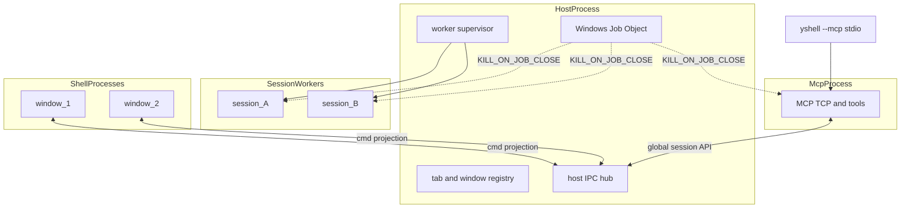
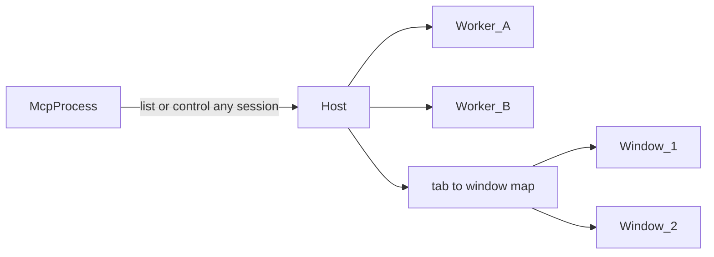

# 进程 / 多窗口架构

性质：多窗口与 MCP 相关的**技术设计真源**（进程边界、所有权、生命周期）。  
产品范围决策见 [`yshell-current-status.md`](../product/yshell-current-status.md) **D38**；UI 观感仍以本目录 HTML 原型为准。

更新：2026-11-11

---

## 1. 目标约束

- **一 session 一进程**：SSH/PTY/SFTP/终端解析在 SessionWorker；单连崩溃或卡死不影响其它 session 与 UI。
- **MCP 独立进程（监听单例）**：不挂在某个 Shell；经 Host **全局**看见/切换全部 session（跨窗）。
- **不用「MCP 宿主窗口」**：MCP 不绑定某扇窗、不维护宿主晋升链。
- **tab / 窗归属在 Host 进程**：跨窗移 tab 只改归属，不重建 Worker。
- **Shell 只做 UI**；**清理权只在 Host 进程**（窗口从不负责杀 Worker）。
- **无任何 UI 窗口 → Host 关机收尸**（与 MCP 无关）。

---

## 2. 四层进程模型

### 所有权

| 进程 | 拥有 | 不拥有 |
|---|---|---|
| **Host 进程** | 单实例锁；tab/window 注册表；Worker/MCP 监督与**唯一清理权**；向 MCP 暴露全局 session 视图 | SSH/PTY、Slint、MCP TCP 监听 |
| **SessionWorker** | 单 session 的连接、PTY/SSH、SFTP、终端 grid/日志句柄 | 窗口列表、MCP listen、杀其它 Worker |
| **McpProcess** | TCP 监听、tool 调度；经 Host 访问全部 session；endpoint 文件 | 绑定某窗；直连 Worker；画 UI |
| **Shell / 窗口** | Slint 展示与输入、对话框展示 | session 连接、MCP listen、tab 真相源、杀 Worker、「MCP 宿主」身份 |

本版不做：一 OS 窗一进程（一个 Shell 进程内仍可多 Slint 窗，对齐现 N7）。

---

## 3. MCP 与窗口

| 点 | 选定默认 |
|---|---|
| 可见性 | MCP（经 Host）枚举/操作**所有** session，不论 tab 在哪扇窗 |
| 切换 | 可随时指定 session；不绑定窗 |
| 新建连接 | Host spawn Worker + 建 tab；**展示落点**用当时合适的窗（如最近聚焦窗）——仅 UI 落点，不是 MCP 归属 |
| 落点窗关了 | tab 按普通关窗/迁窗规则处理；MCP 仍可按 session id 控制其它/新建到别的窗 |
| 退出条件 | **零 UI 窗口** → Host 关机序列；不是「MCP 没宿主」 |

`yshell --mcp`（stdio 桥）仍指向 McpProcess 写出的 endpoint；用户不手跑 `--mcp`（对齐 D34）。

---

## 4. 生命周期与防野 session

**核心原则：Shell 永不负责清理 session。** 窗口只向 Host 报告关窗/Quit；停 Worker / 停 MCP / 释锁只发生在 Host 关机序列。

### 正常路径

1. **关非最后窗**：Host 更新归属；只停本应断开的 Worker。
2. **Quit 或关到零窗**：Host 关机序列（停 McpProcess → 优雅停全部 Worker → 超时强杀 → 清 endpoint / run-state → 释单实例锁 → Host 退出）。
3. **MCP 建连**：全局 API + tab 临时落某窗展示（可带 AI 标志，对齐 D34）。

### 异常路径

| 场景 | 机制 | 结果 |
|---|---|---|
| Host 被杀 / 崩溃 | Worker + Mcp 加入 Host 的 **Windows Job Object**（`KILL_ON_JOB_CLOSE`） | OS 级联杀掉子进程 |
| Job 未生效 | Worker/Mcp **心跳**：IPC 断开或超时无 Host 应答 → **自退出** | 第二道保险 |
| 单窗异常退出 | Host 更新 tab 归属；Worker 保留（仍在其它窗或待附着） | MCP 全局视图不变 |
| **零 UI 窗** | Host **立即**关机序列 | 不把收尸交给已死窗口 |
| 冷启动残留 | 读 `run-state.json` **启动收尸** | 清野 PID / 陈旧 endpoint |
| 再开 yshell | 单实例锁：附着已有 Host，或收尸后起新 Host | 不会第二套 MCP/野 Host |

### run-state（Host 维护）

落在 config_dir（例：`run-state.json`）：

- `generation`（每次 Host 启动递增）
- `host_pid`
- `mcp_pid`（可选）
- `workers: [{ session_id, pid }]`

规则：spawn/exit 同步写；关机成功删除文件；新 Host 杀非本 generation 残留；Worker 启动带 `generation`，心跳不对齐则自退。

### 明确不采用

- MCP 宿主窗口 / 宿主晋升链
- 最后退出的 Shell 负责杀光 session
- MCP 进程随某一个窗口生死
- 无窗后长时间后台挂着一堆 session

### 崩溃语义摘要

- SessionWorker 崩/卡 → 该 tab Faulted，可 Reconnect（新 Worker）。
- McpProcess 崩 → Host 按 Settings 重启或标 Failed；已有 session 保留。
- Shell 崩 → Host 保留 Worker；可再起 Shell 附着（若 Host 尚未因零窗退出）。
- Host 崩 → Job + 下次启动收尸。

---

## 5. 与现状对照

| 能力 | 现状（单 OS 进程 N7） | 目标 |
|---|---|---|
| session I/O | `SessionRuntime` 在 `AppRuntime` 内 | SessionWorker 进程 |
| tabs / 窗归属 | `AppRuntime::windows` | Host 注册表 |
| MCP TCP | GUI 内 `WindowManager::reconcile_mcp_server` | McpProcess；落点由 Host 决定 |
| UI | 同进程 `WindowManager` 多窗 | Shell 进程（内仍可多窗） |
| `yshell --mcp` | stdio 桥 → GUI 内 TCP | stdio 桥 → McpProcess TCP |
| 清理 | 随单进程退出 | 零窗 → Host 关机；Job + 心跳 + 启动收尸 |

---

## 6. 实现分阶段

| 阶段 | 内容 | 验收要点 |
|---|---|---|
| **Phase 1** | 同进程抽出 Host / Session / Mcp / Shell **邮箱 API**（行为不变） | 现有 N7/MCP 行为与单测绿 |
| **Phase 2** | SessionWorker 出进程；纳入 Host Job；心跳 | 杀一 Worker 不影响其它；杀 Host 带走 Worker |
| **Phase 3** | McpProcess 独立；经 Host 全局 session API；建连 tab 临时落窗 | MCP 端口/进程单例；Mcp 挂不影响 session |
| **Phase 4** | Shell/Host 分进程；单实例附着；跨窗移 tab；零窗退出 | 二次启动附着；迁窗不重建 Worker |

CLI 形态（实现期）：

- 默认：ensure Host（或附着）→ Shell
- `--host`：无 UI 协调进程
- `--shell`：仅 UI
- `--session-worker --session-id <id> --generation <n>`
- `--mcp-daemon`：MCP 监听（由 Host 按 Settings 启停）
- 现有 `--mcp`：stdio 桥（不变）

关键落点：`crates/yshell-app`（`runtime/`、`windows.rs`、`session_runtime.rs`、`mcp_server.rs`、`bootstrap.rs`）、`yshell-mcp`；协议 crate `yshell-host-ipc`（或等价模块）；Windows Job Object；`run-state.json`。

---

## 7. 风险

- **Host 必须薄**：禁止在 Host 做阻塞 SSH/大文件 I/O。
- **帧带宽**：Worker → Host → Shell 两跳；优先 dirty 推送，不足再 shared memory。
- **密钥**：明文不进 Shell；Connect 时 Host 向 Worker 投递短时凭证。
- **SFTP 队列**：元数据在 Host，实际读写在对应 SessionWorker。
